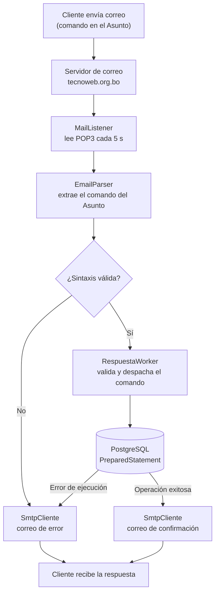

# Sistema Vía Correo Electrónico - Bolsa de Trabajos UAGRM (Grupo 04)

- **Materia:** INF-513 Tecnología Web
- **Docente:** Ing. Evans Balcázar
- **Base de Datos:** PostgreSQL en `mail.tecnoweb.org.bo:5432/db_grupo04sc`
- **Servidor de Correo:** POP3 (110) y SMTP (25) en `mail.tecnoweb.org.bo`

## Descripción

Sistema backend con arquitectura *Email-Driven*: el usuario interactúa con la base de datos enviando comandos en el Asunto de un correo. El servidor lee el correo, valida el comando, ejecuta la operación en PostgreSQL y responde de forma automática al remitente, confirmando el éxito o informando el error.

Un comando tiene la forma `COMANDO[parametro1, parametro2, ...];` y los parámetros se pueden separar por comas (`,`) o por dos puntos (`:`).

## Arquitectura

El sistema sigue un ciclo por cada correo que entra: lectura, análisis, validación, ejecución y respuesta.



Componentes principales (en `src/main/java/bo/uagrm/bolsa/`):

- **MailListener:** demonio que revisa la bandeja por POP3 cada 5 segundos.
- **PopCliente / SmtpCliente:** clientes que leen los correos (POP3) y envían las respuestas (SMTP), en HTML y texto plano.
- **EmailParser:** extrae el comando y sus parámetros del Asunto.
- **RespuestaWorker:** valida la sintaxis con expresiones regulares, identifica el caso de uso y ejecuta la operación SQL correspondiente.
- **DatabaseManager:** administra la conexión a PostgreSQL con un pool de conexiones (HikariCP) y consultas preparadas (PreparedStatement) para evitar inyección SQL.
- **MailFormatter:** arma la respuesta en formato tabla (HTML) y texto.
- **PagoFacilService:** genera el QR y verifica el pago de las suscripciones.

## Estructura de la base de datos

La base `db_grupo04sc` tiene 17 tablas, agrupadas por función:

- **Usuarios y seguridad:** `roles`, `usuarios`, `estudiantes`, `empresas`.
- **Catálogos y relaciones:** `habilidades`, `estudiante_habilidades`, `areas_laborales`, `oferta_habilidades`.
- **Planes, pagos y facturación:** `planes`, `suscripciones`, `pagos`, `facturas`.
- **Ofertas y proceso de selección:** `ofertas`, `postulaciones`, `seguimientos`, `entrevistas`.
- **Control:** `moderaciones` (verificación de empresas y aprobación de ofertas).

Además hay 11 vistas para consultas y reportes: `v_ofertas_disponibles`, `v_ofertas_pendientes_moderacion`, `v_candidatos_oferta`, `v_mis_postulaciones`, `v_entrevistas_programadas`, `v_reporte_empleabilidad`, `v_recaudacion_suscripciones`, `v_ranking_empresas`, `v_facturas_emitidas`, `v_registro_estudiante`, `v_registro_empresa`.

El script completo para crear la base está en `bolsa_trabajo_bd.sql`.

## Requisitos previos

- Java JDK 17 o superior.
- Maven (para compilar).
- Conexión a Internet (para llegar a la base de datos de TecnoWeb).

## Configuración (archivo `.env`)

Las credenciales no se suben al repositorio por seguridad. Antes de ejecutar, creá un archivo llamado `.env` en la raíz del proyecto con este contenido (reemplazá las contraseñas por las reales del grupo):

```
DB_HOST=mail.tecnoweb.org.bo
DB_PORT=5432
DB_NAME=db_grupo04sc
DB_USER=grupo04sc
DB_PASSWORD=tu_contraseña_de_base_de_datos

MAIL_SERVER=mail.tecnoweb.org.bo
MAIL_USERNAME=grupo04sc@tecnoweb.org.bo
MAIL_PASSWORD=tu_contraseña_de_correo
MAIL_POP_PORT=110
MAIL_SMTP_PORT=25
MAIL_REFRESH_TIME_MS=5000
MAX_THREADS=4

PAGOFACIL_BASE_URL=url_del_servicio
PAGOFACIL_TOKEN_SECRET=tu_token_secreto
PAGOFACIL_TOKEN_SERVICE=tu_token_de_servicio
```

## Cómo compilar y ejecutar

Compilar el proyecto con Maven:

```
mvn clean package
```

Para no depender de las restricciones de IP del servidor, el proyecto trae atajos (`.bat`) para Windows:

- **Modo simulador (recomendado para probar):** doble clic en `simular.bat`. Escribí cualquier comando (por ejemplo `HELP;`, `VER_PLANES;`, `VER_OFERTAS;`). Verás la respuesta en la consola y se abrirá `ultima_respuesta.html` en el navegador para ver el diseño tipo tabla. Para cambiar de remitente, usá por ejemplo `rrhh@tigo.com.bo`. Para salir, escribí `salir`.
- **Probar tu IP:** doble clic en `probar_ip.bat`. Te dice si tu proveedor de Internet está autorizado en el servidor (verde) o no (rojo, "Relaying denied"). Si sale rojo, podés pasarle tu IP al docente para que la habilite, o seguir usando el simulador.
- **Servidor de correo real:** doble clic en `ejecutar.bat` (solo si tu IP está autorizada). El sistema se conecta a `grupo04sc@mail.tecnoweb.org.bo` cada 5 segundos, procesa los correos entrantes y envía las respuestas oficiales.

## Comandos disponibles por caso de uso

Los comandos aceptan separación por comas (`,`) o por dos puntos (`:`).

**CU1. Usuarios y Roles**
```
REGISTRAR_DIRECTOR[ci, nombre, apellido, email, password, telefono];
REGISTRAR_SECRETARIA[ci, nombre, apellido, email, password, telefono];
REGISTRAR_ESTUDIANTE[ci, nombre, apellido, email, password, telefono, ru, carrera, semestre, perfil, cv_url];
REGISTRAR_EMPRESA[ci, nom_rep, ape_rep, email, password, tel, nit, razon, comercial, rubro, direccion];
LIST[usuarios];   LIST[roles];   SHOW[usuarios: id];
```

**CU2. Perfil del Estudiante**
```
SHOW[estudiantes: id];
UPDATE[estudiantes: id, campo=nuevo_valor];
```

**CU3. Perfil de la Empresa**
```
SHOW[empresas: id];
UPDATE[empresas: id, campo=nuevo_valor];
```

**CU4. Suscripciones y Publicación de Ofertas**
```
VER_PLANES;
COMPRAR_PLAN[empresa_id, plan_id];
VERIFICAR_PAGO[pago_id];
PUBLICAR_OFERTA[empresa_id, titulo, area, salario, modalidad, vacantes, skills];
LIST[planes];   LIST[suscripciones];
```

**CU5. Ofertas y Postulaciones**
```
VER_OFERTAS;
POSTULAR[oferta_id, estudiante_id, mensaje];
MIS_POSTULACIONES[estudiante_id];
```

**CU6. Candidatos, Selección y Citas**
```
VER_CANDIDATOS[oferta_id];
EVALUAR_CANDIDATO[postulacion_id, etapa, observaciones];
AGENDAR_ENTREVISTA[postulacion_id, fecha_hora, modalidad, enlace_meet, entrevistador, telefono];
```
Etapas válidas: `REVISION_CV`, `PRESELECCIONADO`, `ENTREVISTA`, `CONTRATADO`, `NO_SELECCIONADO`.

**CU7. Moderación (Director)**
```
MODERAR[EMPRESA|OFERTA, id, APROBAR|RECHAZAR, motivo];
```

**CU8. Reportes Analíticos**
```
REPORTE[empleabilidad];
REPORTE[postulaciones];
REPORTE[recaudacion];
REPORTE[empresas];
REPORTE[facturas];
```

## Bitácora del servidor (logs de auditoría)

El sistema registra automáticamente todas las peticiones en archivos rotativos dentro de la carpeta `logs/`:

- `logs/access.log`: fecha, hora, remitente, asunto, comando ejecutado, estado (ÉXITO/ERROR) y tiempo de procesamiento en milisegundos.
- `logs/error.log`: advertencias y excepciones del servidor.
